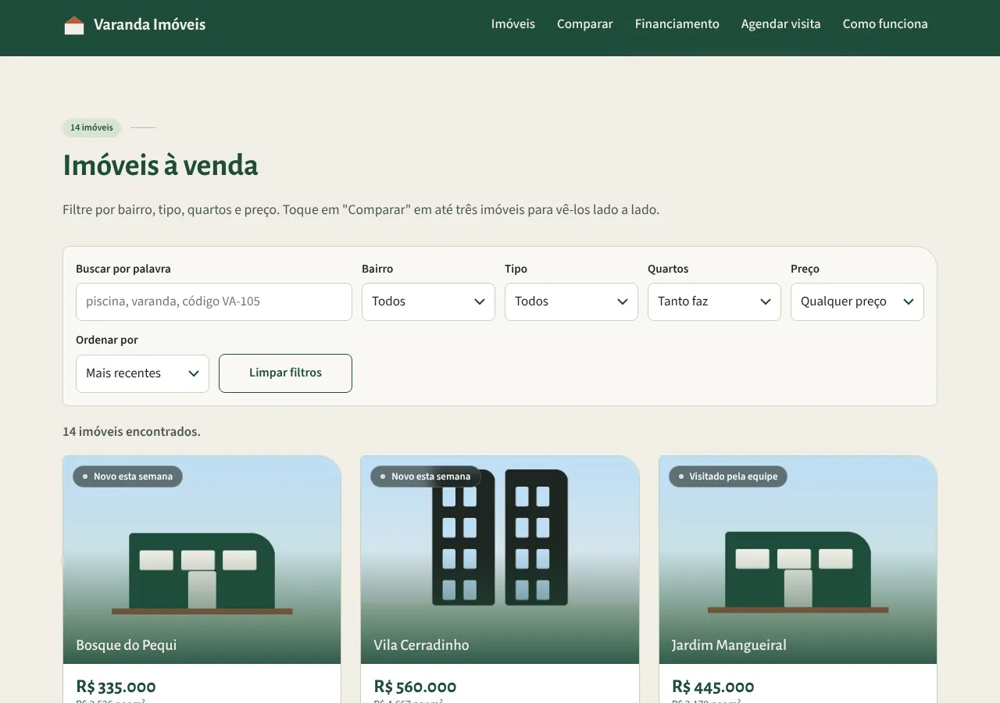
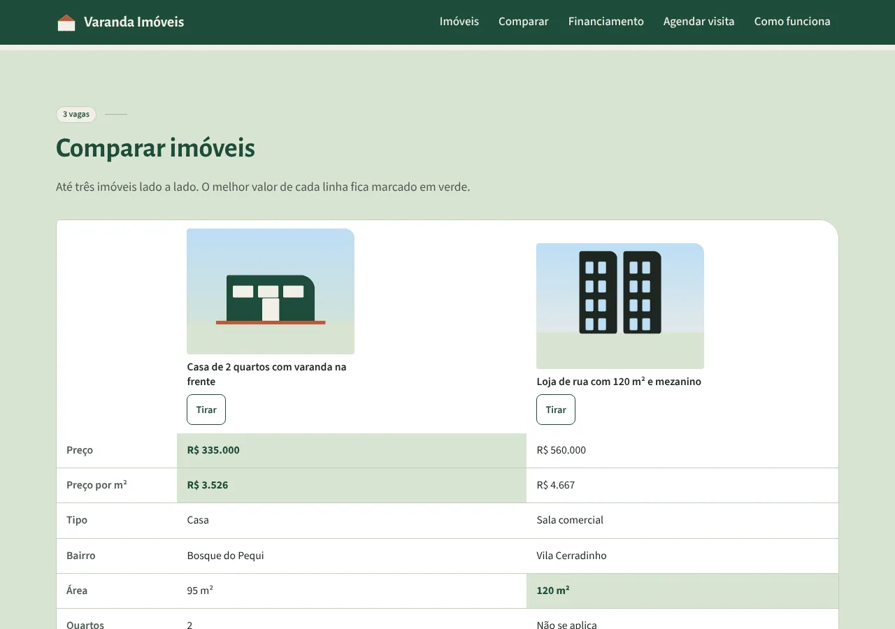
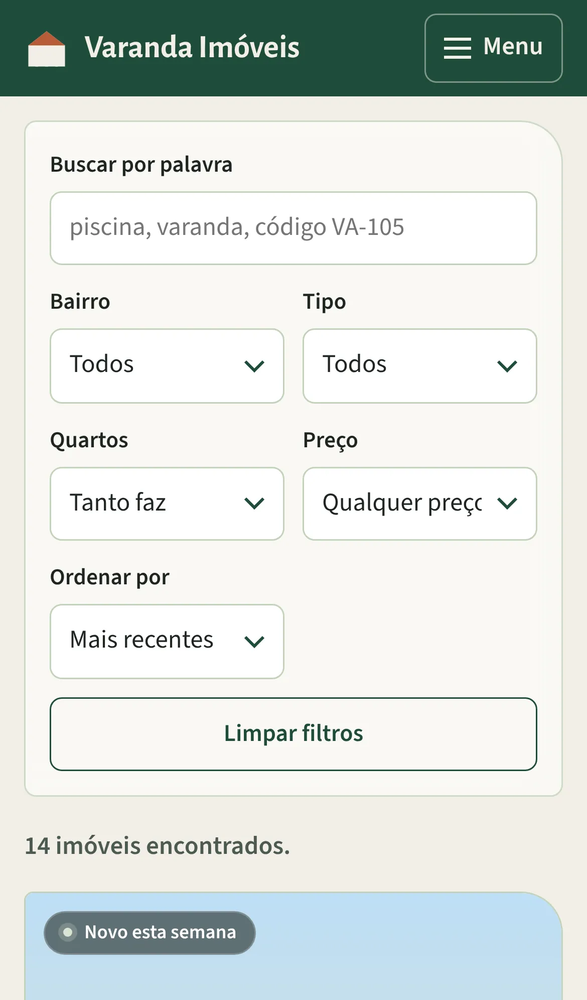
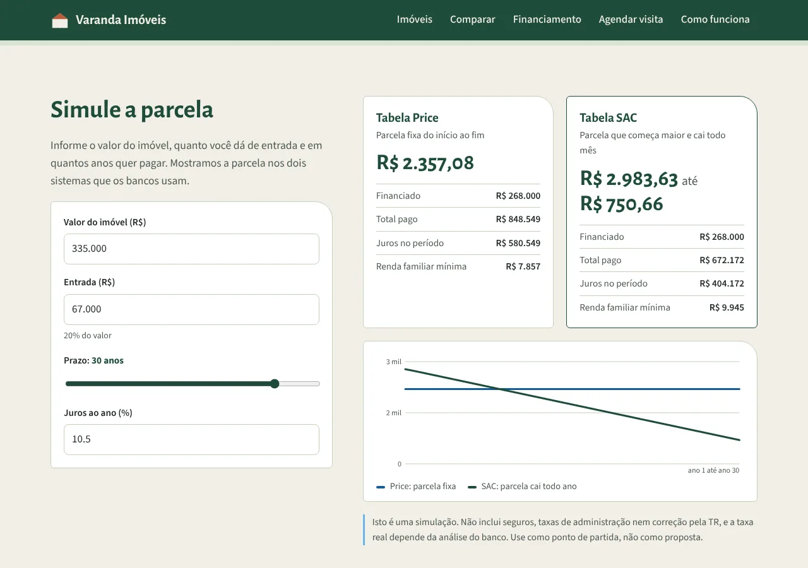
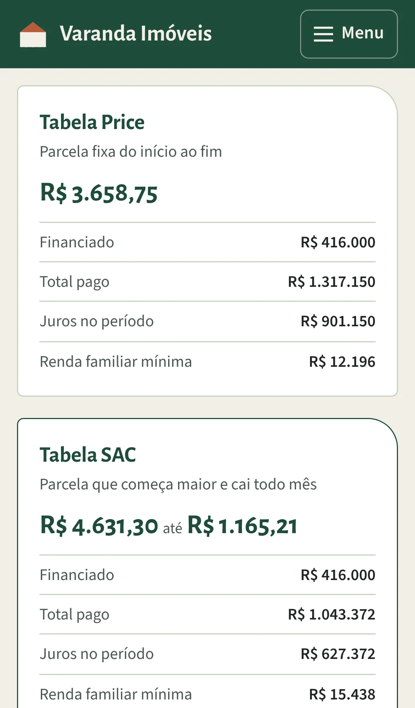
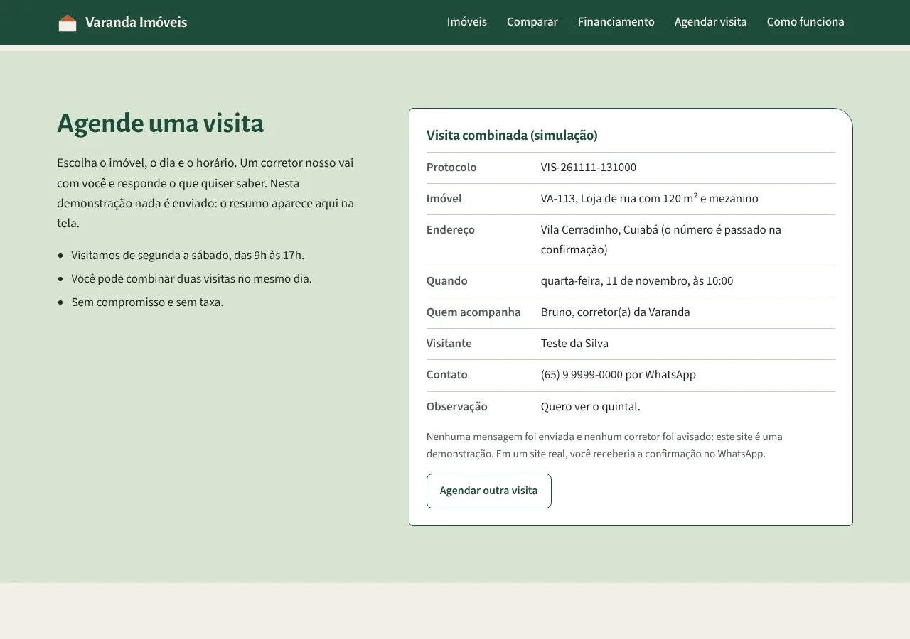

# Varanda Imóveis: site de demonstração para corretores de imóveis

Eu sou o Rodrigo Jr, da [Mil e Uma Linhas!](https://mileumalinhas.com.br), em Cuiabá. Este site é uma demonstração do que eu faço para corretores e imobiliárias pequenas: um site bonito, com identidade própria, que não só mostra os imóveis, mas funciona. Dá para filtrar e ordenar os imóveis, comparar três lado a lado, simular a parcela do financiamento e combinar uma visita.

Site publicado: https://toshiro01001.github.io/imoveis/

**Aviso importante: tudo aqui é fictício.** A Varanda Imóveis não existe. Os imóveis, os bairros, os preços, as fotos, os corretores, o endereço e o telefone foram inventados por mim para a demonstração. Nenhuma visita é marcada de verdade, nenhuma proposta é feita e nenhum dado sai do seu navegador.


## O que o site faz (para quem não é da área)

Imagine o site de uma imobiliária de bairro. Você entra, diz em que bairro quer morar e que tipo de imóvel procura, e aparece a lista. Refina por quartos e faixa de preço, ordena do mais barato para o mais caro ou pelo menor preço por metro quadrado. Marca até três imóveis e vê os dois ou três lado a lado numa tabela, com o melhor valor de cada linha em destaque. Toca em "Simular parcela" e descobre quanto pagaria por mês nos dois sistemas que os bancos usam (Price e SAC), com um gráfico. E, quando gostar de um, escolhe dia e horário e recebe o resumo da visita.

Tudo isso acontece na hora, sem carregar outra página, no celular ou no computador.

## Como usar, passo a passo

1. Abra o site. No alto, escolha o bairro e o tipo de imóvel e toque em "Ver imóveis". A lista aparece logo abaixo, já filtrada.
2. Nos filtros, refine por quartos e faixa de preço, digite uma palavra ("piscina", "varanda", o código do imóvel) ou mude a ordenação. A lista se ajusta sozinha.
3. Em cada cartão, toque em "Mais sobre o imóvel" para ver a descrição, os destaques, condomínio e IPTU.
4. Toque em "Comparar" em até três imóveis. A seção "Comparar imóveis" monta a tabela e marca em verde o melhor valor de cada linha. "Tirar" remove um deles.
5. Toque em "Simular parcela" em um cartão. O simulador recebe o valor do imóvel e sugere 20% de entrada. Ajuste entrada, prazo (5 a 35 anos) e juros ao ano e veja a parcela Price, a primeira e a última parcela SAC, o total pago, os juros e a renda mínima.
6. Toque em "Agendar visita". Escolha o dia (de amanhã a 60 dias, sem domingo), o horário, preencha nome e telefone e toque em "Confirmar visita simulada". Aparece o resumo com protocolo e o corretor que acompanha. Nada é enviado.

## Capturas

| Computador | Celular |
|---|---|
|  |  |
|  |  |
|  |  |
|  | |

## Identidade visual (resumo)

O estudo completo está em [`docs/identidade.md`](docs/identidade.md), inclusive o prompt da foto do hero.

- **Nome e frase:** Varanda Imóveis. "Imóveis em Cuiabá, escolhidos por quem mora aqui."
- **Ideia central:** a varanda, o lugar entre a rua e a casa onde se recebe gente em Cuiabá. Confiança local, sem terno.
- **Paleta:** Areia `#F1EEE6` (fundo), Branco (superfícies), Cerrado `#1F4D3A` (identidade, cabeçalho, títulos), Carvão `#1E2622` (texto), Folha `#D9E4D3` (apoio) e Céu `#6CB8EE` (destaque, um só botão por tela). A telha `#B85C38` aparece só no telhado da marca e nos erros. Fugi de propósito do azul-marinho com dourado das imobiliárias e do creme com terracota dos sites gerados.
- **Forma:** o "canto de telhado", um único canto grande arredondado no alto à direita de cartões, formulários e da foto do hero. É a silhueta de uma casa com beiral.
- **Fontes:** Alegreya Sans nos títulos e preços (humanista, traço caligráfico, lembra letreiro pintado) e Source Sans 3 no texto e nos formulários (neutra, ótima em tela pequena). As duas são locais, em `fonts/`, com licença SIL OFL.
- **Movimento:** só um momento orquestrado na abertura (a foto se revela e o texto sobe) e respostas às ações. Com "reduzir movimento" ligado no aparelho, nada se mexe.
- **Imagens:** a foto do hero é uma foto gerada por IA no Canva (ilustrativa, não é uma obra real). As fotos dos 14 imóveis ainda são provisórias, geradas em Python nas cores da identidade, até eu trocar pelas fotos finais.

## Como funciona por dentro (em linguagem comum)

Pense numa pasta de anúncios muito bem organizada. Os 14 imóveis, os 6 bairros, as faixas de preço e os horários de visita estão escritos dentro do próprio site, no arquivo `js/dados.js`. Quando você filtra, compara, simula ou agenda, o navegador do seu aparelho lê essa pasta, faz a conta e desenha a resposta na tela. Nada é enviado para a internet e nada fica guardado no aparelho: recarregou, zerou.

- **Busca:** a cada filtro trocado, o site percorre a lista e mostra só o que combina com bairro, tipo, quartos mínimos, faixa de preço e palavra digitada; depois ordena do jeito escolhido.
- **Comparador:** guarda até três códigos de imóvel e monta a tabela. Em cada linha com número (preço, área, quartos, condomínio...), compara os valores e marca o melhor.
- **Simulador:** usa as fórmulas da Tabela Price (parcela fixa) e do SAC (amortização constante, parcela que cai). A taxa anual vira mensal por juros compostos. O gráfico é desenhado em SVG a partir das parcelas de cada ano.
- **Agendamento:** confere imóvel, dia (de amanhã a 60 dias, sem domingo), horário, nome com sobrenome e telefone com DDD, formata o telefone e monta o resumo. O corretor é escolhido pelo código do imóvel, para parecer uma agenda real.

## Detalhes técnicos

- HTML, CSS e JavaScript puros. Sem framework, sem biblioteca, sem CDN, sem fonte externa, sem analytics.
- `Content-Security-Policy` por meta tag: `default-src 'self'`, sem script inline, sem atributo `style`, `connect-src 'none'`, `form-action 'none'`. Detalhes em [`docs/vistoria.md`](docs/vistoria.md).
- Todo conteúdo gerado entra na página por DOM (`createElement`, `textContent`), sem `innerHTML`.
- Price: `P = V · i / (1 − (1 + i)^−n)`. SAC: amortização `V / n`, juros sobre o saldo devedor. Taxa mensal `i = (1 + a)^(1/12) − 1`. Renda mínima considera parcela de até 30% da renda.
- Acessibilidade: contraste AA em todas as combinações da paleta, foco visível, `aria-live` na contagem de resultados e na nota do comparador, botões "Comparar" com `aria-pressed`, tabela com `caption` e `scope`, gráfico SVG com `aria-label` descritivo, erros com `role="alert"`, `lang="pt-BR"`, `prefers-reduced-motion` respeitado.
- Celular primeiro: uma coluna a partir de 320px, duas colunas de cartões a partir de 600px, três a partir de 960px. A tabela do comparador rola na horizontal dentro da própria caixa no celular.
- Arquivos: `index.html`, `404.html` (caminhos absolutos `/imoveis/`), `robots.txt`, `sitemap.xml`, verificação do Google, `css/estilo.css`, `js/app.js`, `js/dados.js`, `img/`, `fonts/`, `docs/`, `tests/site.cjs`.

## Como rodar

Não precisa instalar nada para ver o site: basta abrir `index.html` no navegador. Para servir como no GitHub Pages:

```
python3 -m http.server 8311
```

e abrir http://localhost:8311/.

## Testes

Os testes usam Playwright e rodam em três telas: computador (1280x900), iPhone 13 e um celular estreito de 320px. Em cada tela conferem a abertura, a busca (filtros do hero, limpar, quartos, faixa, ordenação, palavra e lista vazia), o comparador (limite de três, melhores valores, tirar e limpar), o simulador (preenchimento pelo cartão, Price e SAC, gráfico, erro de entrada), o agendamento (validações de data, domingo, telefone e o resumo), que nada fica no navegador, o menu do celular e a página 404. Também verificam rolagem horizontal, elementos fora da borda, texto cortado e erros de console.

```
npm install playwright
python3 -m http.server 8311
node tests/site.cjs
```

Para salvar capturas: `CAPTURAS=pasta node tests/site.cjs`.

## Segurança

Vistoria completa em [`docs/vistoria.md`](docs/vistoria.md). Resumo: CSP restritiva, nenhum envio de dados, nenhuma gravação no aparelho, nenhuma dependência em produção, nenhum dado real no repositório.

## Sobre

Feito por Rodrigo Jr, [Mil e Uma Linhas!](https://mileumalinhas.com.br), Cuiabá, Mato Grosso. Quer um site assim para a sua imobiliária, com os seus imóveis e as suas fotos? Fala comigo.
